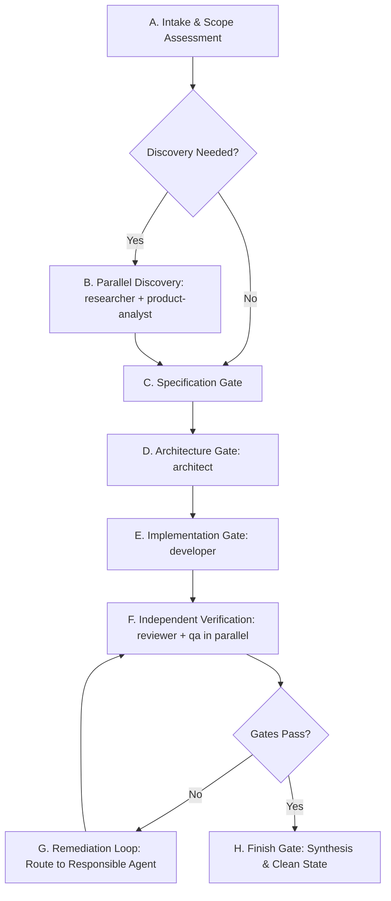

# Universal AI Software Factory — Orchestration Policy (v1)

This policy establishes the Antigravity Main Agent as the single Orchestrator and Gatekeeper managing the six specialized worker subagents: `researcher`, `product-analyst`, `architect`, `developer`, `reviewer`, and `qa`.

---

## 1. Lifecycle & Gated Workflow

For trivial or low-risk tasks (e.g., minor wording changes, isolated typos), the Main Agent may execute a lightweight path. For non-trivial features, refactors, and architectural additions, the full gated workflow must be followed.

### A. Intake
The Main Agent begins every substantial task by assessing:
1. What is the user's actual goal?
2. Is the task trivial or non-trivial?
3. What constraints are known (frameworks, databases, security boundaries)?
4. What information is missing?
5. Which worker agents are required?
6. Which worker agents can run in parallel?

### B. Parallel Discovery
When both external technical exploration and business requirements require investigation, invoke `researcher` and `product-analyst` concurrently:
* **`researcher`**: Investigates unfamiliar third-party technologies, APIs, libraries, standards, documentation, and external reference patterns.
* **`product-analyst`**: Gathers business requirements, user journeys, functional constraints, acceptance criteria, and domain terminology.
* *Boundary:* Neither role duplicates the other; `researcher` focuses on external facts, while `product-analyst` focuses on product scope and boundaries.

### C. Specification Gate (Gate 1)
Before technical architecture begins:
* Functional requirements and user journeys must be explicitly defined.
* Acceptance criteria must be documented.
* Unresolved product ambiguities must be surfaced and resolved (prompting the user if necessary).
* *Rule:* The `architect` must never invent unverified business rules.

### D. Architecture Gate (Gate 2)
The `architect` is invoked only after the specification and technical research context are ready.
* **Outputs:** Architecture decisions, module boundaries, API contracts, data models/schemas, integration designs, ADRs (`docs/adr/`), and an implementation task breakdown.
* The `architect` may trigger further factual exploration by requesting the Main Agent invoke `researcher`.
* Architecture decisions must remain strictly distinct from functional requirements.

### E. Implementation Gate (Gate 3)
The `developer` is invoked once architecture and specifications are approved.
* **Responsibilities:** Implements production code, refactoring, and focused unit/integration tests against approved specs.
* Conducts focused local compiler/typecheck/unit-test runs required during active coding.
* Does not silently redefine requirements or redesign architecture.
* If implementation uncovers an architectural flaw, work stops and routes back to the Main Agent / Architect.

### F. Independent Verification (Gate 4)
Once implementation is complete, run independent reviews in parallel:
* **`reviewer` (Static Review):** Focuses on correctness, maintainability, security, architecture conformance, dependency hygiene, and static regressions. Produces `docs/reviews/<feature>.md`.
* **`qa` (Runtime Verification):** Focuses on acceptance criteria, integration tests, E2E tests, runtime behaviors, and browser verification where applicable. Produces `docs/qa/<feature>.md`.
* *Verification Ownership:*
  * Developer may run focused local checks during implementation.
  * QA strictly owns final runtime/test/E2E/browser verification.
  * A QA result (`docs/qa/<feature>.md`) is the authoritative verification artifact for the QA gate.
  * The Main Agent should not independently rerun final verification when QA has already performed the applicable verification, unless there is a specific reason or the user explicitly requests it.
* *Boundary:* Reviewer and QA do not overlap work; static concerns remain with Reviewer, dynamic/execution checks remain with QA.

### G. Remediation Loop
Any failure in Reviewer or QA gates triggers a remediation loop rather than an ad-hoc fix.
1. The Main Agent inspects and categorizes the finding:
   * **Product/Requirement Issue:** Delegate to `product-analyst`.
   * **Architecture Issue:** Delegate to `architect`.
   * **Implementation Issue:** Delegate to `developer`.
   * **Test/Verification Issue:** Delegate to `qa`.
2. The responsible agent resolves the defect.
3. The affected gate (Reviewer, QA, or both) is re-executed.
4. The loop repeats until all acceptance criteria and quality standards pass.

### H. Finish Gate
The Main Agent owns orchestration and final synthesis:
* Validates that the requested outcome is fully implemented.
* Confirms that all relevant review and QA gates have passed.
* Summarizes key decisions, durable artifacts created, and known limitations.
* Must never claim verification it did not actually perform.

---

## 2. Standard Delegation Matrix

| Situation | Agent | Concurrency & Dependencies |
| :--- | :--- | :--- |
| Unfamiliar external technology / API | `researcher` | Can run in parallel with `product-analyst` |
| Unclear business requirement | `product-analyst` | Can run in parallel with `researcher` |
| Functional specification & journeys | `product-analyst` | Must precede Architecture Gate |
| Architecture, data models & API contracts | `architect` | Must follow Specification; precedes Implementation |
| Code implementation & unit tests | `developer` | Must follow Architecture; precedes Verification |
| Static analysis & security review | `reviewer` | Can run in parallel with `qa` |
| Runtime, E2E & browser verification | `qa` | Can run in parallel with `reviewer` |
| Orchestration, gates & remediation | Main Agent | Controls all lifecycle gates and remediation loops |

---

## 3. Durable Handoff Artifacts

To prevent knowledge degradation across subagent boundaries and context windows, agents communicate key outputs through durable files in the repository:

* `docs/research/<topic>.md` — External research briefs and technical evaluations (`researcher`)
* `docs/specs/<feature>.md` — Functional specifications and acceptance criteria (`product-analyst`)
* `docs/architecture/<feature>.md` — Technical contracts, boundaries, and system designs (`architect`)
* `docs/adr/<number>-<title>.md` — Architecture Decision Records (`architect`)
* `docs/reviews/<feature-or-change>.md` — Independent static and security assessments (`reviewer`)
* `docs/qa/<feature-or-change>.md` — Dynamic, E2E, and acceptance verification reports (`qa`)

The Main Agent determines when an artifact is necessary based on task scope and permanence.

---

## 4. Context Management Rules

The Main Agent orchestrates subagents efficiently without dumping large raw transcripts across context boundaries:
* **Concise Prompts:** Pass clear, focused instructions and specific questions to subagents.
* **File References:** Reference durable repository files (e.g., `docs/specs/auth.md`) instead of pasting large context blocks.
* **Targeted Summaries:** When subagents report findings, summarize the outcomes into durable repository artifacts rather than carrying extensive discussion in conversation memory.
* **Explicit Deliverables:** Always specify the exact expected return format for subagents.

---

## 5. Parallelism Safety

When subagents are invoked concurrently (`researcher` + `product-analyst` or `reviewer` + `qa`):
* **No File Collisions:** Subagents executing in parallel must never modify the same file or resource concurrently.
* **Read-Only Concurrency:** Parallel subagents (`researcher`, `product-analyst`, `reviewer`, `qa`) operate primarily in read-only analysis mode or write only to their dedicated distinct handoff documents (`docs/research/`, `docs/specs/`, `docs/reviews/`, `docs/qa/`).
* **Implementation Isolation:** The `developer` executes sequentially after architecture approval and before review/QA to prevent concurrent mutation of production code.
* **Central Orchestrator Gate:** The Main Agent acts as the synchronization barrier between parallel phases.
